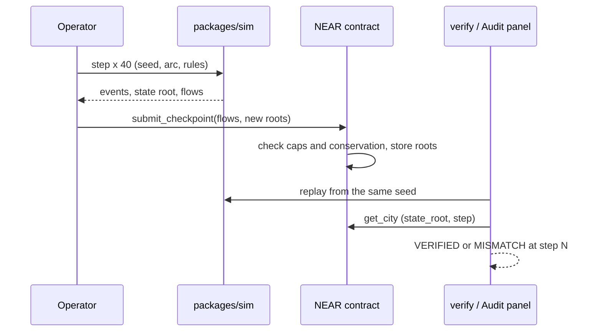
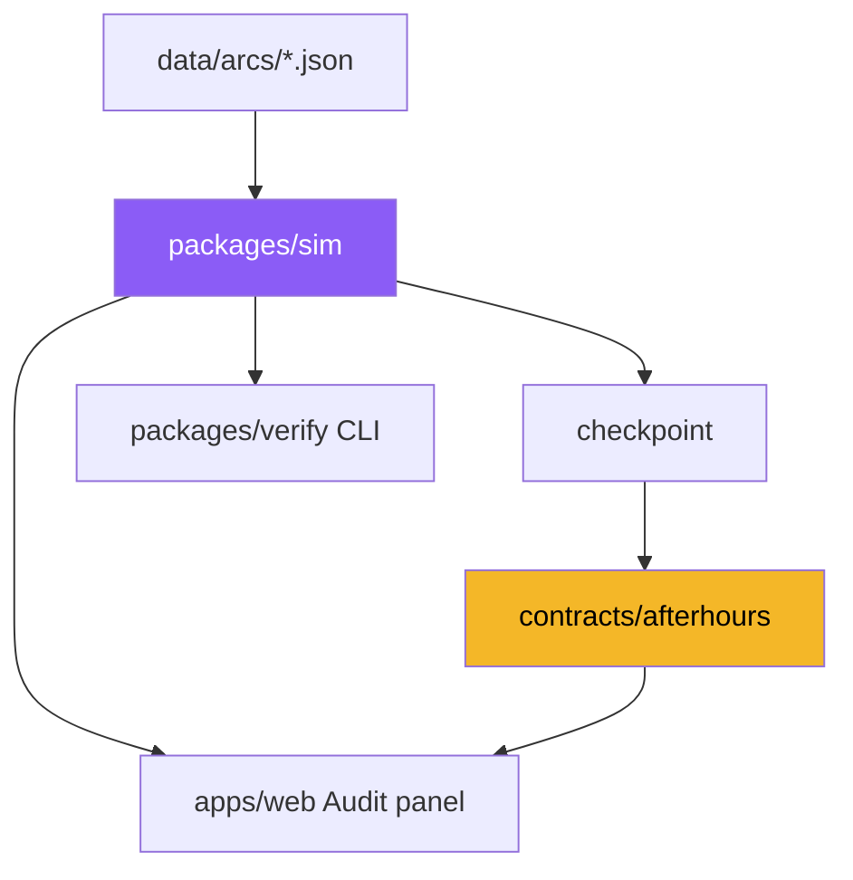

<h1 align="center">AfterEarth</h1>

<p align="center"><b>A fantasy world where merchants trade around the clock, cities can be sold, and every century of history can be replayed and checked against a root hash on NEAR.</b></p>

<p align="center">
  
  
  
  
  
</p>

> Working title was AfterHours; the product name is **AfterEarth**. Status: work in progress, built for the NEAR HACKATHON. Code in this repository was started on 2026-11-04.

---

**AfterEarth is for players and judges who want an on-chain economy they can actually audit.** Four fantasy cities (Goblin Warrens, Cave Hold, Dino Vale, Elf Grove) run a full supply chain: farms, mills, bakeries, forges, workshops, alchemists. Citizens eat, businesses hire, go bankrupt, and new entrepreneurs open shops. One step is one season; the simulation covers 500 years.

> **The promise: nothing the operator says about the world has to be taken on trust.**
> - The simulation is deterministic and has no dependencies. Anyone replays it from the seed.
> - The contract stores a hash chain of state roots and checks conservation of every item and every coin.
> - A browser Audit panel replays the city and compares its root with the one on NEAR. Tamper with a checkpoint and it prints `MISMATCH`.
>
> It does **not** run the whole simulation on-chain, and it does not claim emergent behaviour it cannot show.

## Documentation

| Section | Where |
|---|---|
| Data contract (arcs, checkpoint shape, caravans, world runner) | [`docs/data-contract.md`](docs/data-contract.md) |
| Web design notes (arc themes, bubbles, daylight rule) | [`apps/web/DESIGN.md`](apps/web/DESIGN.md) |
| Contract source | [`contracts/afterhours/src`](contracts/afterhours/src) |
| Simulation source | [`packages/sim/src`](packages/sim/src) |

## What Makes AfterEarth Special

### Who This Is For

Meet **Rin**, who plays economy games and distrusts every leaderboard. She wants to know that the market she trades in is not rigged by whoever runs the server. She does not want to read Rust; she wants a button that says *verified*.

### The Problem

- **Opaque economies**: players cannot tell whether prices, scarcity and rewards are fair.
- **Off-chain history**: a "500-year world" is just a database the operator can edit.
- **Assets without provenance**: cities and designs get sold, but nobody can prove what they were.

**How might we make a living game economy whose entire history anyone can replay and check?**

### The Solution

1. **Deterministic simulation**: pure TypeScript, bigint math, seeded PRNG, no dependencies. Same seed, same history, byte for byte.
2. **Hash-chained roots**: each step commits to events and a per-sector Merkle tree, so a sector can be sold with a proof.
3. **Conservation on-chain**: the contract rejects any checkpoint where items or coin appear from nowhere, bounded by per-arc caps.
4. **Replay verifier**: a CLI and a browser panel rebuild the roots and report `VERIFIED` or the first step that differs.
5. **A market**: cities can be listed and bought on-chain; players can write rule-based trading agents scored by a verifiable backtest.

## Features

- **Four Arcs**: Goblin Warrens, Cave Hold, Dino Vale, Elf Grove, each with its own recipes, prices, events and look.
- **Living Cities**: bankruptcies, new entrepreneurs, population growth, four seasons per year.
- **Isometric Pixel Art View**: fixed bright daytime, per-arc palettes, per-season variants, clickable icon bubbles.
- **Audit Panel**: replay in the browser, tamper demo, compare with the NEAR testnet city root.
- **Agent Rules**: a small rule language (max 8 rules, 3 conditions, fee per rule) with a verifiable backtest score and leaderboard.
- **City Market**: `list_city`, `cancel_listing`, `buy_city` with escrow-style payout in NEAR.
- **Inter-City Caravans**: Dino Vale ships bread to Elf Grove; both cities record the flows and the contract invariants still hold.

## Tech Stack

| Layer | Technology |
|---|---|
| Simulation, rules, verifier | TypeScript on Node 24+ (native `.ts`, no build step, no dependencies) |
| Smart contract | Rust, near-sdk 5, NEP-245 style multi-token balances |
| Frontend | Next.js 16, React, PixiJS |
| Chain | NEAR testnet only |

## Architecture





## Try It in Two Minutes

Requires Node 24+ (and Rust only if you want the contract tests).

```bash
git clone https://github.com/theodhorex/AfterHours && cd AfterHours
node scripts/demo_mock.ts          # 200 steps, 5 checkpoints, replay -> VERIFIED
node --test packages/sim/test/     # simulation tests
cd apps/web && pnpm install && pnpm dev   # open http://localhost:3000
```

In the web app: pick a world, press **Fast-Forward**, open the **Audit** panel and press **Tamper with checkpoint 2** to see `MISMATCH ... new_state_root mismatch at step 80`. Open **Trade routes** and run the 400-step caravan world.

> Two traps worth knowing: the production build (`next build`) is not yet proven green on every machine (see Build Checklist), and `pnpm verify` replays the *current* engine, so a city published by an older engine version will not match.

## How It Works

```
step (season)  ->  events + state root + sector Merkle roots
40 steps       ->  Checkpoint { flows per item, coin flows, roots, order ids }
contract       ->  require(caps) ; require(conservation) ; store roots
verify         ->  replay from seed ; compare every root
```

Conservation per item: `old_total + produced + sourced + from_players >= consumed + sunk + to_players`, applied on-chain to every checkpoint.

## Testnet Deployment

| Item | Value |
|---|---|
| Network | NEAR testnet (no real funds) |
| Contract v2 (with market) | `afterhours-11042023-theo.testnet` |
| Status | deployed and initialised; the four demo cities are being republished after a simulation engine fix |
| First slice (v1, kept as evidence) | `afterhours-11041910-theo.testnet`, city `city-goblin_warrens`, 200 steps, state root `bc4fe79a...54ac` matched the local replay |

The transaction table for the republished cities will be added here with explorer links. Testnet only; no secrets are committed.

## Threat Model

| Threat | Defence | Test |
|---|---|---|
| Operator edits history | hash chain plus replay | tamper test, `MISMATCH` |
| Operator mints items or coin | on-chain conservation and per-arc caps | contract tests (80) |
| Selling someone else's city | owner check on `list_city` | market tests |
| Storage drain by dust transfers | `storage_deposit` required for receivers | `RECEIVER_NOT_REGISTERED` tests |
| TS and Rust disagree on caps or shapes | differential tests against a generated fixture | `arc_caps_fixture`, `differential_tests` |

## Repository Layout

```
data/        arc definitions, pricing and growth rules, generated fixtures
packages/    sim (deterministic engine), rules (agent language), verify (replay CLI)
contracts/   afterhours (NEAR contract, Rust)
apps/        web (Next.js frontend)
scripts/     demo_mock, testnet_publish, gen_arc_caps, economy_report
docs/        data contract
```

## Build Checklist

- [x] Deterministic simulation with conservation and checkpoints
- [x] Contract: checkpoints, storage deposit, city market, differential tests
- [x] Replay verifier CLI and browser Audit panel (compares with the NEAR city root)
- [x] Four arcs with distinct looks, clickable icon bubbles
- [x] Agent rules, verifiable backtest, leaderboard
- [x] Inter-city caravans (library, world runner, web panel)
- [x] First testnet city with matching root
- [ ] Economy tuning: some cities stall or collapse on some seeds (engine fix in progress)
- [ ] Republish four cities to the v2 contract with a transaction table
- [ ] Production `next build` proven green on a clean machine
- [ ] Contract-side caravan settlement (today caravans are checked per city only)

**One limitation worth naming:** the operator is trusted for availability, ordering and fairness of orders, not for conservation or history. City sales are paid in NEAR on testnet, not in game coin, and the sale price is not part of the replayed economy.

## Hackathon Notes

- Code started 2026-11-04. The author also submits a separate NEAR project, Scrip; each README links the other.
- AI assistance was used throughout development (planning, review and code generation with Claude and other models). Libraries are standard open source; no third-party game art is used, all sprites are drawn procedurally.
- Testnet only. No real funds.

## Project Info

| | |
|---|---|
| Name | AfterEarth (working title AfterHours) |
| Track | Games With Real Economies |
| Chain | NEAR testnet |
| License | MIT |

> Every number in this world can be replayed. Do not trust it, check it.
