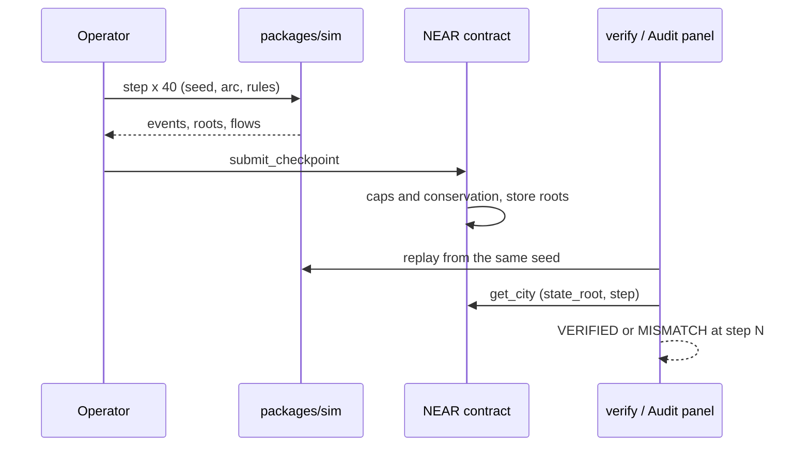

# AfterEarth

**A fantasy economy you can audit: four cities trade around the clock, cities can be sold, and every season of history can be replayed and checked against a root hash on NEAR.**

Four fantasy cities run a full supply chain: farms, mills, bakeries, forges, workshops, alchemists. Citizens eat, businesses hire, some go bankrupt, and new entrepreneurs open shops. One step is one season. The simulation is deterministic and has no dependencies, so anyone can rebuild the same history from the same seed and compare it with the roots the contract stores. The working title was AfterHours; the product name is AfterEarth.

Built for the **NEAR HACKATHON**, track **Games With Real Economies**. Code started on 2026-11-04. Status: work in progress, testnet only.

- **Contract (v2, with city market):** [`afterhours-11042023-theo.testnet`](https://testnet.nearblocks.io/address/afterhours-11042023-theo.testnet)
- **First verified slice (v1):** [`afterhours-11041910-theo.testnet`](https://testnet.nearblocks.io/address/afterhours-11041910-theo.testnet), city `city-goblin_warrens`, 200 steps
- **Network:** NEAR testnet, no real funds
- **Repository:** https://github.com/theodhorex/AfterHours
- **AI assistance and libraries:** [`docs/AI_AND_LIBRARIES.md`](docs/AI_AND_LIBRARIES.md)

## Try It in Two Minutes

You need Node 24 or newer. No install step for the simulation (TypeScript runs natively, zero dependencies).

1. **Do:** `git clone https://github.com/theodhorex/AfterHours && cd AfterHours`
2. **Do:** `node scripts/demo_mock.ts`
   **See:** 200 steps in five windows, then `VERIFIED: 5 checkpoints match the replay`.
3. **Do:** `cd apps/web && pnpm install && pnpm dev`, open http://localhost:3000.
   **See:** an isometric pixel-art city. Pick a world, press **Fast-Forward**.
4. **Try:** open the **Audit** panel and press **Tamper with checkpoint 2**.
   **See:** `MISMATCH ... new_state_root mismatch at step 80`. The replay caught the edit.
5. **Try:** open **Trade routes** and run the 400-step caravan world.
   **See:** Dino Vale ships bread to Elf Grove, both cities book the flows, badge **Conservation: OK**.

> Note: `pnpm verify` replays the current engine. A city published to testnet by an older engine version will not match until it is republished (see Limits).

## Developer Setup

**Tests.**

```bash
node --test packages/sim/test/         # simulation, caravans, growth (162 tests, 2026-11-04)
node --test packages/verify/test/      # replay verifier
cd apps/web && node --test test/       # web logic, audit, a11y (109 tests)
cd contracts/afterhours && cargo test --lib   # contract (80 tests)
```

**Replay a checkpoint file against the engine.**

```bash
node packages/verify/cli.ts --arc goblin_warrens --seed demo --city city-goblin_warrens --checkpoints demo/checkpoints.json
```

**Publish a city to your own testnet account.** Needs the `near` CLI and an account whose key is in the legacy keychain. Testnet only.

```bash
cd contracts/afterhours && cargo build --release --target wasm32-unknown-unknown
node scripts/testnet_publish.ts <your-account>.testnet
```

## The Problem

Game economies are black boxes. Players cannot tell whether prices, scarcity and rewards are fair, "500 years of history" is a database the operator can edit, and assets such as cities and designs are sold without any proof of what they were.

AfterEarth makes the history itself the product: a deterministic world whose every root hash is stored on-chain and can be recomputed by anyone.

## How It Works

```
step (one season)  ->  events, state root, per-sector Merkle roots
40 steps           ->  Checkpoint { item flows, coin flows, roots, order ids }
contract           ->  check arc caps, check conservation, store roots
verify / Audit     ->  replay from the seed, compare every root, report the first step that differs
```

Conservation per item, enforced on every checkpoint:

```
old_total + produced + sourced + from_players  >=  consumed + sunk + to_players
```



## Features

**Four arcs.** Goblin Warrens, Cave Hold, Dino Vale, Elf Grove. Each has its own recipes, prices, events, palette and signature props.

**Living cities.** Bankruptcies, new entrepreneurs, population growth through stages, four seasons per year.

**Audit.** A browser replay with a tamper demo, plus a button that compares the replayed root with the city root stored on NEAR through the public RPC.

**City market.** `list_city`, `cancel_listing`, `buy_city` with an NEAR payout to the seller.

**Agents.** A small rule language (at most 8 rules, 3 conditions each, a fee per rule) with a backtest score anyone can reproduce, and a leaderboard.

**Inter-city caravans.** Goods move between two cities; the seller records a sink and receives coin, the buyer records a source and pays coin. Per-city conservation holds and the sum over both cities is unchanged.

**Isometric view.** Pixel-sharp rendering, fixed bright daytime, per-season variants, clickable icon bubbles (hungry citizens, idle shops, events, trades).

## Security: Threat Model

| ID | Threat | Defence | Test |
|---|---|---|---|
| T1 | Operator edits history | hash chain plus replay, first differing step reported | `tamper`, `root_vectors` |
| T2 | Operator inflates the city economy | per-arc caps on produced, consumed, sourced, sunk; per-checkpoint conservation | `checkpoint_tests` |
| T3 | Operator mints player assets | **partial**: genesis totals and `trade_to_players` are operator-declared; capping them is in progress | review finding 1 |
| T4 | Selling a city you do not own | owner check in `list_city` | `market_tests` |
| T5 | Storage drain through dust transfers | `storage_deposit` required for receivers | `RECEIVER_NOT_REGISTERED` tests |
| T6 | TS and Rust disagree on caps or shapes | differential tests against a generated fixture | `arc_caps_fixture`, `differential_tests` |
| T7 | Replay of an old checkpoint | `from_step` must equal the stored step | `checkpoint_tests` |

An independent review of the contract (a different model from the one that wrote the code) found 14 issues on 2026-11-04: 1 high (T3), 4 medium, the rest low or informational. Fixes are scheduled and tracked in the Progress Log.

## Measured on Testnet

| What | Result |
|---|---|
| Contract v1 account | `afterhours-11041910-theo.testnet` |
| Arc registered | [`HhamH2JA...R73`](https://testnet.nearblocks.io/txns/HhamH2JAWy2Xzr33gtWJb4SRg2hMhCCgsSSFTbeLpR73) |
| City created | [`8Tc1wjwZ...sHH`](https://testnet.nearblocks.io/txns/8Tc1wjwZPKREUDXfw1oiPFs8wKiYuEjrzxYWs8sUHKH) |
| Checkpoint 0 to 40 | [`6aPz2kdH...kZ`](https://testnet.nearblocks.io/txns/6aPz2kdH2yR12KM3qrUuSNgEyqKnKwkuuYGQtkQWbkuZ) |
| Checkpoint 40 to 80 | [`2MNM6QHo...e3`](https://testnet.nearblocks.io/txns/2MNM6QHo9tYcrvmqaQZzTPeSHo966TiW1A7xy8VWBie3) |
| Checkpoint 80 to 120 | [`5pQBBhJc...Rd`](https://testnet.nearblocks.io/txns/5pQBBhJcuxPzEAEcWSWZprG3hwKoJtcXeJHq8rRn8Ryd) |
| Checkpoint 120 to 160 | [`5HMkLBUn...7P`](https://testnet.nearblocks.io/txns/5HMkLBUnGYuzNWNBtTXfJSJB4ndmf8xiU95nMRyAQ7tP) |
| Checkpoint 160 to 200 | [`Dt5AEsz7...Fg`](https://testnet.nearblocks.io/txns/Dt5AEsz7J52iZ58XSyy8jNeg7H4VmuThgjWpyqgU2FcG) |
| On-chain state root at step 200 | `bc4fe79adc950876fc4cfd873fae3234124bf0d26dc5f059f5029e8798d754ac` |
| Local replay root at step 200 | identical (2026-11-04) |
| Contract v2 (with market) | deployed and initialised, `get_listing` answers `null`; the four cities will be republished here |

These transactions were made by the engine version of 2026-11-04 afternoon. The engine was fixed afterwards (stalled cities, see Progress Log), so the v1 city is kept as evidence of the mechanism, not as a current replay target.

## What NEAR Makes Possible Here

- **Cheap, public checkpoints.** A root and a few flow counters per 40 steps fits easily in a transaction, so every season stays checkable.
- **Fast finality.** A buyer can wait for a checkpoint to land before paying for a city.
- **Native accounts and storage accounting.** Receivers register with `storage_deposit`; dust attacks cost the attacker.
- **Public RPC.** The browser Audit panel reads the city root straight from NEAR, with no server of ours in the loop.

## Limits, Stated Plainly

- **Testnet only.** No real funds, no mainnet deployment, no token launch.
- **The operator is trusted for availability, ordering and fairness of orders.** History is checkable by replay and the city economy is conserved on-chain. But genesis totals and player-bound transfers are still operator-declared today (finding 1 of the review).
- **City sales are paid in NEAR on testnet, not in game coin.** The sale price is not part of the replayed economy.
- **Caravans are checked per city, not settled jointly on-chain.** Each city's checkpoint must conserve; the contract does not see the counterparty.
- **The economy is tuned, not proven.** Stage and population reach differ per arc and seed; see the Progress Log for the current numbers. We make no claim of emergent behaviour.
- **Replay needs the same engine.** A city published by an older engine will show `MISMATCH` against a newer one by design.

## Progress Log

Updated after each accepted milestone.

| Date | Milestone |
|---|---|
| 2026-11-04 | Repo started. Deterministic simulation, conservation, checkpoints, replay verifier, contract with NEP-245 style balances |
| 2026-11-04 | First testnet city: on-chain state root matched the local replay at step 200 |
| 2026-11-04 | City market, TS vs Rust differential tests, browser Audit against the NEAR root |
| 2026-11-04 | Four arc themes, icon bubbles, inter-city caravans (library, world runner, web panel), clean production build from a fresh copy |
| 2026-11-04 | Accessibility pass: AA contrast, 44 px touch targets, scroll regions, live status, reduced motion |
| 2026-11-04 | Independent contract review: 14 findings (1 high, 4 medium); fixes in progress |
| 2026-11-04 | Growth engine fix: a stock-cap rule mismatch closed healthy businesses. Dino Vale now reaches stage 4 on three seeds, Cave Hold stage 2; Elf Grove still stalls at stage 1 (in progress) |

## Repository Layout

```
data/        arc definitions, pricing and growth rules, generated fixtures
packages/
  sim/       deterministic engine, checkpoints, caravans, world runner
  rules/     agent rule language and backtest
  verify/    replay CLI
contracts/
  afterhours/  NEAR contract (Rust, near-sdk 5)
apps/
  web/       Next.js frontend (isometric view, Audit, Trade routes, Agents)
scripts/     demo_mock, testnet_publish, gen_arc_caps, economy_report
docs/        data contract, AI and library disclosure
```

## Built With

- TypeScript on Node 24+ for simulation, rules and verifier (no dependencies)
- Rust and near-sdk 5.30 for the contract
- Next.js 16, React 19 and PixiJS 8 for the web app
- All sprites are drawn procedurally; no third-party art

## Hackathon Notes

- Code started 2026-11-04. The author also submits a separate NEAR project, Scrip; each README links the other.
- AI assistance was used throughout (planning, review, code generation); details in [`docs/AI_AND_LIBRARIES.md`](docs/AI_AND_LIBRARIES.md).

## License

MIT.

## About

AfterEarth: a world whose history anyone can replay. Do not trust the operator, check the roots.
